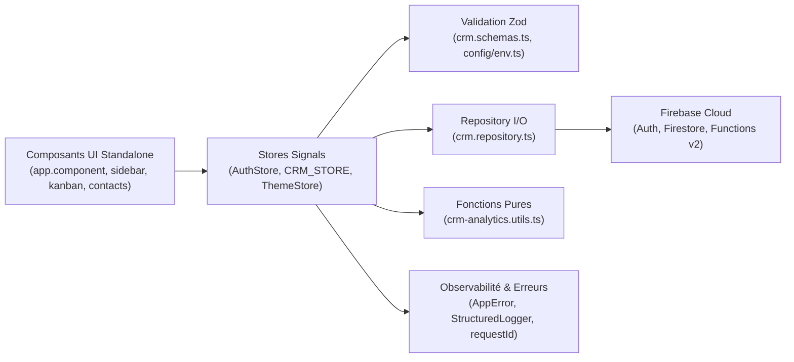
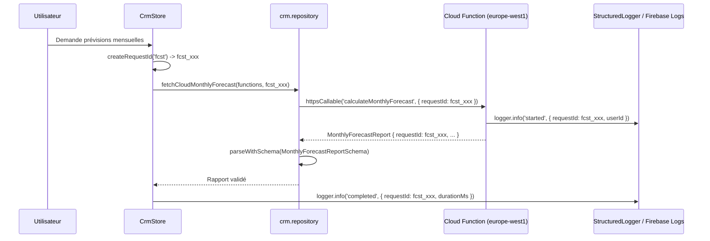

# Architecture — PulseCRM

## Vue d'ensemble

PulseCRM suit une séparation stricte par responsabilité :

## Organisation des dossiers

- `src/app/core/config/` — Configuration validée au démarrage (`env.ts`).
- `src/app/core/errors/` — `AppError` (et sous-classes), catalogue `error-codes.ts`, `GlobalErrorHandler`.
- `src/app/core/observability/` — `StructuredLogger` (redaction automatique + ring buffer) et générateur `requestId`.
- `src/app/core/schemas/` — Schémas Zod (`NewContactPayloadSchema`, `NewDealPayloadSchema`, `NewActivityPayloadSchema`, `MonthlyForecastReportSchema`).
- `src/app/core/repositories/` — Couche d'accès Firestore & Cloud Functions (`crm.repository.ts`).
- `src/app/core/state/` — Stores réactifs basés sur Angular Signals (`crm.store.ts`, `theme.store.ts`, `crm-seed.data.ts`).
- `src/app/core/auth/` — Authentification Firebase & mode démo (`auth.store.ts`).
- `src/app/core/utils/` — Fonctions métier pures et déterministes (`crm-analytics.utils.ts`).
- `src/app/shared/layout/` — Composants de layout partagés (`app-sidebar.component.ts`).
- `src/app/features/` — Vues métier (`auth`, `contacts`, `dashboard`, `pipeline`).
- `functions/src/index.ts` — Cloud Functions v2 (`onDealWon`, `calculateMonthlyForecast`).

## Traçabilité bout-en-bout (`requestId`)

## Isolation des données (`ownerId`)

- Toutes les requêtes Firestore filtrent strictement par `where('ownerId', '==', user.uid)`.
- Les règles [firestore.rules](../firestore.rules) imposent `isOwner(resource.data)` en lecture/écriture/suppression et `keepsImmutableOwner()` en mise à jour.
- La Cloud Function `calculateMonthlyForecast` filtre également ses lectures par `request.auth.uid`.
